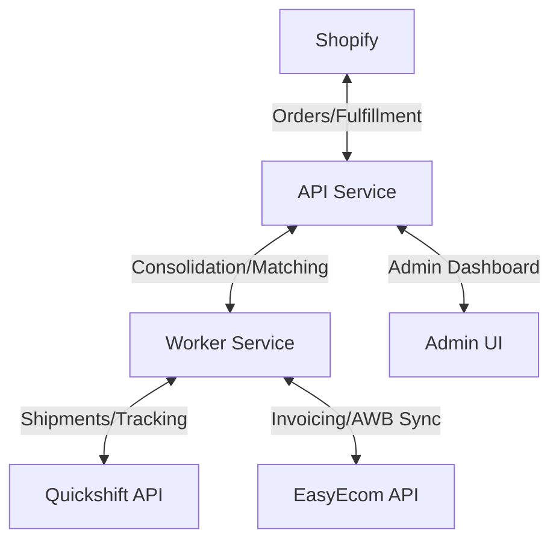

# Shipping Combinator Architecture

## System Context
Shipping Combinator acts as the integration layer between Shopify (orders), Quickshift (shipments), and EasyEcom (inventory/invoicing).

## Data Model (Prisma)
- **Consolidation**: Grouping entity for orders.
- **OrderLink**: Links Shopify Orders to a Consolidation.
- **Shipment**: Linked to OrderLink + Quickshift shipment ID.
- **AWBSync**: Tracks AWB status per order/invoice in EasyEcom.
- **IdempotencyKey**: Stores result of critical operations.

## Integration Contracts
Interfaces in `src/integrations/{shopify,easyecom,quickshift}/adapter.ts`:
- `ShopifyAdapter`: FetchOrders, CreateFulfillment
- `EasyEcomAdapter`: CreateOrder, UpdateTrackingStatus
- `QuickshiftAdapter`: CreateShipment, GetLabel

## Event Flow
1. **Ingest**: BullMQ `ingest-orders` (Shopify/EasyEcom)
2. **Match/Consolidate**: `match-orders` (Admin UI trigger)
3. **Approve**: Admin approves Consolidation
4. **Ship**: `create-shipment` (Quickshift)
5. **Sync**: `sync-awb` (EasyEcom)
6. **Fulfill**: `create-fulfillment` (Shopify)
7. **Track**: Webhook processing + Audit Log

## Idempotency Strategy
- Client-provided idempotency keys (`X-Idempotency-Key` header/stored in DB)
- Storage: Redis for fast lookup + DB for long-term consistency.

## Admin Approval Gate
- Consolidation state machine: `pending` → `approved` → `shipment_created`
- API rejects shipment creation if state != `approved`.

## Deployment
- Railway Services: `api` (Fastify), `worker` (BullMQ), `admin` (Next.js)
- Postgres + Redis (managed)

## Risk Register
1. Duplicate consolidation: Mitigation via idempotency key + DB constraint.
2. Webhook race: Mitigation via idempotency + reconciliation on each webhook.
3. AWB collision: Mitigation per EasyEcom research.
4. Quickshift multi-order failure: Mitigation via per-order shipments.
5. Approval bypass: Mitigation via state machine enforcement in API.
